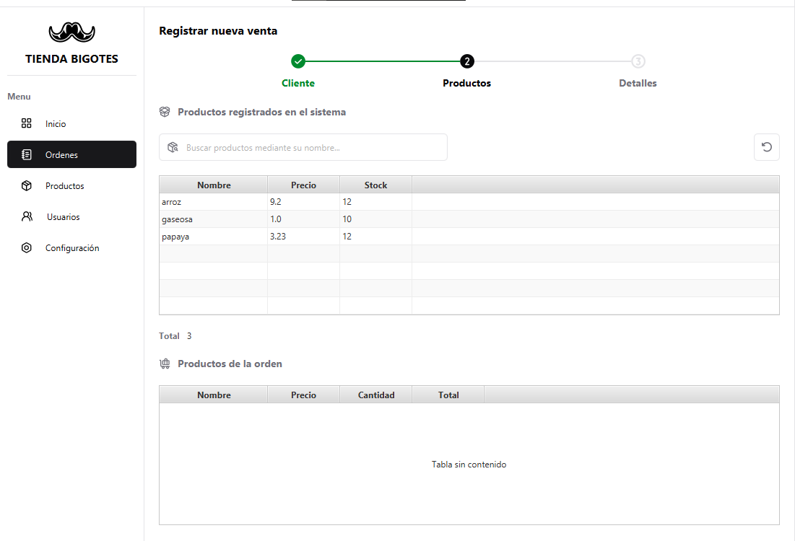
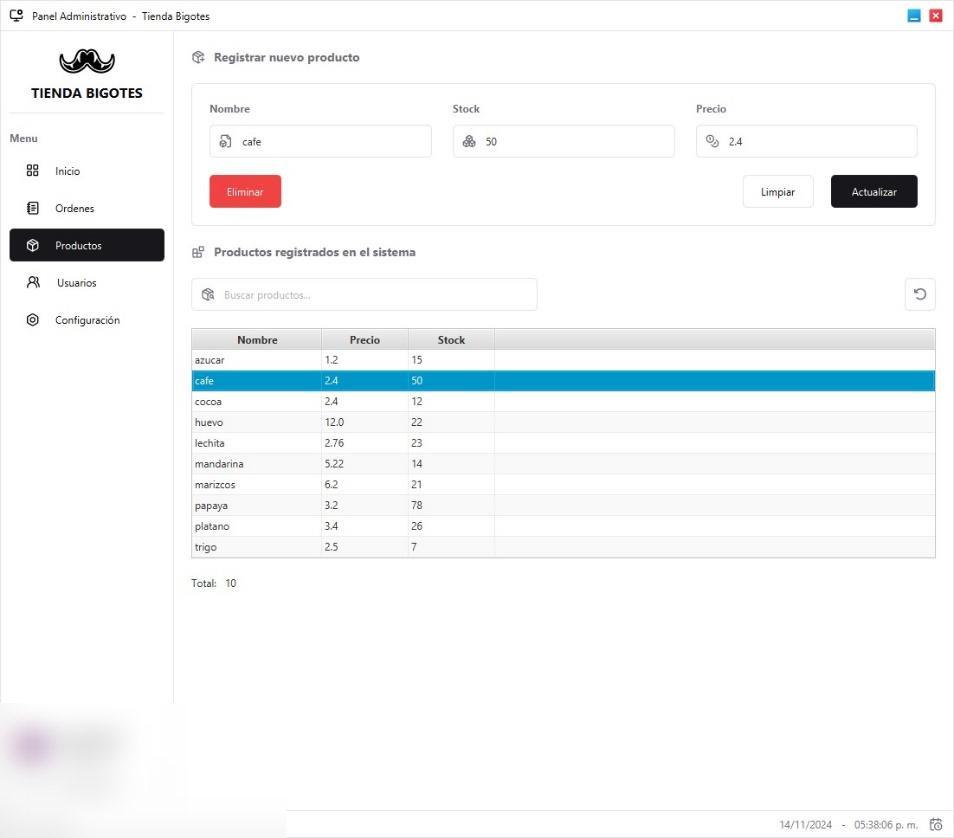
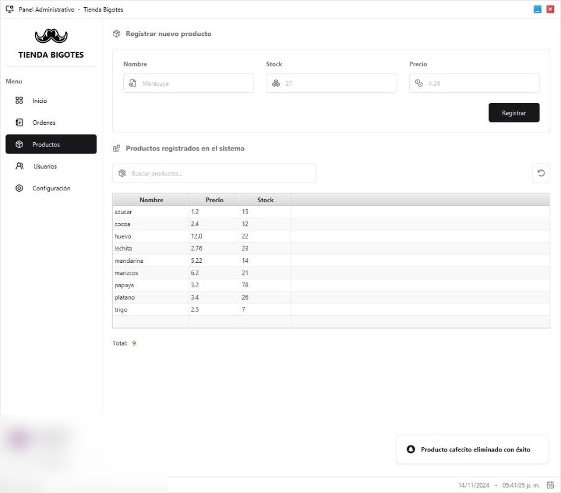
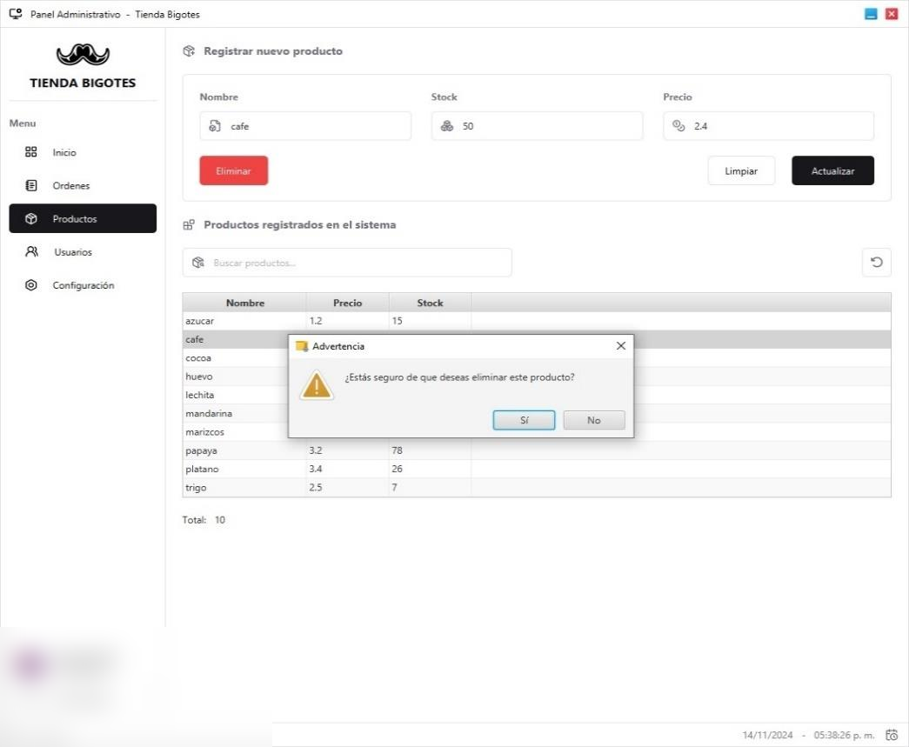

<h1 align="center">Tienda Bigotes – Sistema de Gestión de Ventas e Inventarios</h1>

<p align="center">
  Aplicación de escritorio en Java y JavaFX para digitalizar las operaciones de una tienda de barrio real en Carabayllo, Lima.
</p>

<p align="center">
  
  
  
  
</p>

---

## Sobre el proyecto

Tienda Bigotes es un negocio familiar que llevaba el control de ventas e inventario de forma manual. Este sistema reemplaza ese control con una aplicación de escritorio modular que registra ventas, administra productos y existencias, emite comprobantes y genera reportes. Actualmente se usa en el negocio.

Nació como proyecto del curso **Técnicas de Programación Orientada a Objetos** (UPN, 2024) y se llevó a un uso real en la tienda.

## Módulos

| Módulo | Qué hace |
|---|---|
| **Seguimiento de ventas** | Registro de los datos del cliente, búsqueda de productos y armado del pedido. |
| **Mantenimiento de inventarios** | Alta, edición y eliminación de productos, precios y existencias. |
| **Facturación** | Emisión de boletas y facturas. |
| **Gestión de usuarios** | Inicio de sesión con roles (administrador y vendedor), registro de usuarios, edición de perfil y cambio de contraseña. |
| **Reportes** | Reportes de ventas e inventarios para apoyar la toma de decisiones. |

## Capturas de pantalla

| Registro de venta | Inventario |
|---|---|
|  |  |

| Registrar producto | Confirmación al eliminar |
|---|---|
|  |  |

## Tecnologías

- **Lenguaje:** Java (JDK 21 o superior)
- **Interfaz gráfica:** JavaFX 22
- **Gestión del proyecto:** Maven (incluye Maven Wrapper: `mvnw`)
- **Base de datos:** PostgreSQL
- **IDE recomendado:** IntelliJ IDEA
- **Control de versiones:** Git

## Requisitos previos

- JDK 21 o superior
- JavaFX 22
- PostgreSQL instalado y en ejecución
- IntelliJ IDEA (recomendado)

## Instalación y ejecución

1. Clona el repositorio:

   ```bash
   git clone https://github.com/LEGOL4/Tienda-Bigotes.git
   ```

2. Abre la carpeta del proyecto en IntelliJ IDEA y deja que Maven descargue las dependencias.
3. Configura la conexión a PostgreSQL (servidor, puerto, nombre de la base de datos, usuario y contraseña) según tu entorno.
4. Compila con **Build → Build Artifacts**.
5. Ejecuta el archivo `moustacheshop.jar`.
6. Inicia sesión con las credenciales de administrador.

**Alternativa en Windows:** ejecuta el proyecto con JavaFX usando los archivos `script.bat` o `start.vbs`.

## Estructura del repositorio

```
Tienda-Bigotes/
├── .mvn/wrapper/    # Maven Wrapper
├── images/          # Logo e imágenes del proyecto
├── src/main/        # Código fuente de la aplicación
├── pom.xml          # Configuración de Maven
├── mvnw, mvnw.cmd   # Scripts del Maven Wrapper
└── README.md
```

## Autores

Proyecto desarrollado en el curso **Técnicas de Programación Orientada a Objetos** (Universidad Privada del Norte, 2024), docente José Antonio Ogosi Auqui.

- Abel Leonardo Rojas Asto – [@LEGOL4](https://github.com/LEGOL4)
- Jerimy Johan Estelo Arismendiz
- Adriano Pacheco Manrique
- Alexander Joshef Palomino León

## Contacto

Abel Leonardo Rojas Asto · rojasastoabel@gmail.com · [GitHub](https://github.com/LEGOL4)
